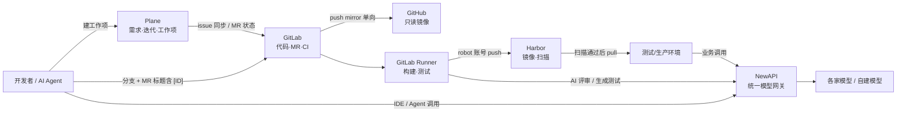

最近组长在内网部署了四个东西：**本地 GitLab**（远端 GitHub 做同步仓库）、**本地 Plane**（协作开发）、**本地 Harbor**（镜像仓库）、**NewAPI**（模型网关）。

单看每一个都不新鲜，但放在一起，我觉得它们刚好把一个小团队在 AI 时代需要的几条主线都管起来了：**需求在哪、代码在哪、产物在哪、模型从哪调**。这篇是我查完官方文档后的整理，也是我自己理解中的「团队工作架构」。

> 说明：组里具体的版本、网络拓扑、权限划分我这里不写，也有不少还没定；下文凡是标「待确认」的，都是我的设想，不是现状。

<!-- more -->

## 一、为什么是这四块

传统的研发协作大概是：需求管理 + 代码托管 + CI/CD + 制品仓库。AI 时代多出了一样东西——**模型调用**。现在 IDE 补全、代码评审 Agent、CI 里自动生成测试、业务服务本身，都要调大模型。如果每个人、每个服务各自拿各自的 Key 去连各家厂商，很快就会出现：

- Key 散落在各种 `.env` 和 CI 变量里，谁在用、用了多少说不清；
- 换模型要改一堆配置；
- 出了问题无法按人、按项目追溯。

所以我对这套架构的一句话理解是：

**Plane 管「做什么」，GitLab 管「怎么做」，Harbor 管「做出了什么」，NewAPI 管「用什么智能」。**

## 二、四个组件各自负责什么

### 1. GitLab：代码主仓 + CI，GitHub 只做镜像

GitLab 自带 **Push mirroring**（推送镜像），免费版就有。官方文档里几个值得注意的点：

- 推送镜像是「下游被动接收」，**不要直接往下游（GitHub）推提交**，否则会分叉；
- 上游有推送后，镜像大约 **5 分钟**内同步；勾选「Only mirror protected branches」则约 **1 分钟**；
- 默认情况下，如果下游分支出现了分歧，**上游会覆盖下游的改动**；勾选「Keep divergent refs」则跳过该分支并标记失败；
- 推到 GitHub 需要一个 **fine-grained PAT**，给目标仓库 Contents 读写权限；如果仓库里有 `.github/workflows`，还要给 Workflows 读写权限；
- GitHub 按提交邮箱归属作者，邮箱没在 GitHub 验证过的，提交会显示为未关联用户。

所以方向一定要定死：**GitLab 是唯一真源（source of truth），GitHub 只读展示/备份**。PR 想在 GitHub 上收？那就需要另一套流程，别混用。

### 2. Plane：需求与迭代

Plane 是开源的项目管理工具，有 Work items（工作项）、Cycles（迭代）、Modules（模块）等概念，可以自托管。它和 GitLab 的官方集成能做两件事：

- **Issue 同步**：GitLab issue 打上 `plane` 标签就会在 Plane 生成工作项；双向模式下，Plane 工作项打 `gitlab` 标签也会在 GitLab 建 issue，评论也能同步；
- **MR 状态自动化**：在 MR 标题或描述里写 `[WEB-344]`（**带方括号、大写**），Plane 会随 MR 的草稿/打开/评审/合并/关闭推动工作项状态；不带括号只做关联。注意 Plane **只读 MR 标题和描述，不读分支名和提交信息**，`closes`、`fixes` 关键字也没用。

> ⚠️ 待确认：官方文档里，自托管 Plane 接 GitLab 自托管（Plane 里叫 Gitlab Enterprise）有额外配置，且文档标注了 Commercial Edition。我们部署的是哪个版本、集成能不能用，需要看实际部署。

### 3. Harbor：镜像与制品仓库

Harbor 的关键是 **Robot Account（机器人账号）**：

- 项目级机器人账号只能在本项目内操作，系统管理员还可以建跨项目的系统级机器人账号（v2.2+）；
- 机器人账号**不能登录 UI**，只用于 `docker login` / API；
- 可以设置过期时间，权限可以细分；**Push 权限必须连同 Pull 一起授予**；
- **Harbor 不保存 secret**，创建时只能导出一次，丢了只能刷新。

CI 里推镜像就用机器人账号，**不要用个人账号**。另外 Harbor 自带漏洞扫描（常见配 Trivy）、标签不可变规则、保留策略等，适合作为「能不能部署」的一道闸。

### 4. NewAPI：团队唯一的模型入口

NewAPI（QuantumNous/new-api）在官方描述里是一个「统一的 AI 模型聚合与分发中心」，能把多家模型转成 **OpenAI 兼容、Claude 兼容或 Gemini 兼容**的格式，定位是个人和企业的集中式模型网关。社区常用的能力包括：

- **渠道（Channel）**：接入不同厂商或自建模型，可做多渠道负载与故障切换；
- **令牌（Token）**：给每个人/项目发独立 Key，可设额度、可用模型、过期时间；
- **用量与计费**：按令牌统计调用量和花费。

> ⚠️ 待确认：具体的限流、模型路由、计费细节以我们实际部署的版本为准，这里只写方向。

## 三、整体架构



一个需求的完整生命周期大概是：

1. **想法 → Plane 工作项**：比如 `AI-42 接入日报摘要`，放进当前 Cycle；
2. **开分支 + MR**：MR 标题写 `[AI-42] 日报摘要接口`，Plane 自动把状态推到「进行中 / 评审中」；
3. **CI**：Runner 跑测试；可选一个 job 调 NewAPI 做 AI Code Review，把意见评论回 MR；
4. **构建镜像**：用 Harbor 机器人账号推送，标签用 commit SHA；
5. **扫描与晋级**：Harbor 扫描通过，再打 `release` 之类的标签或复制到正式项目；
6. **部署**：环境从 Harbor 拉取；
7. **合并**：MR 合并，Plane 工作项自动「完成」；GitLab 在 1～5 分钟内把主干同步到 GitHub。

CI 片段大概长这样（变量名是我起的，地址待确认）：

```yaml
build-image:
  stage: build
  image: docker:27
  services: [docker:27-dind]
  script:
    - echo "$HARBOR_ROBOT_SECRET" | docker login "$HARBOR_HOST" -u "$HARBOR_ROBOT_USER" --password-stdin
    - docker build -t "$HARBOR_HOST/myproj/app:$CI_COMMIT_SHORT_SHA" .
    - docker push "$HARBOR_HOST/myproj/app:$CI_COMMIT_SHORT_SHA"
  rules:
    - if: $CI_COMMIT_BRANCH == $CI_DEFAULT_BRANCH
```

## 四、一张表看清分工

| 组件 | 回答的问题 | 关键对象 | 凭证建议 | 主要坑 |
| --- | --- | --- | --- | --- |
| Plane | 做什么、谁做、什么时候 | 工作项、Cycle、Module | 集成用专门账号 | MR 必须写 `[ID]`；自托管集成版本限制 |
| GitLab | 代码怎么改、怎么验 | 分支、MR、Pipeline | 受保护变量 + Masked | 镜像方向别反 |
| GitHub | 对外展示/异地备份 | 镜像仓库 | fine-grained PAT，单仓库 | 直接往 GitHub 推会被覆盖或分叉 |
| Harbor | 产物是什么、能不能上线 | 项目、镜像、标签 | 项目级 robot，设过期 | secret 只显示一次 |
| NewAPI | 用哪个模型、花了多少 | 渠道、令牌、额度 | 每人/每项目一个令牌 | 厂商 Key 只放网关里 |

## 五、权限、密钥和可观测性

我觉得这套架构最大的价值其实不在功能，而在**收口**：

- **模型 Key 只存在 NewAPI 的渠道里**。个人、CI、Agent、服务拿到的都是 NewAPI 令牌，离职/泄露直接禁用一个令牌就行；
- **镜像推送只用 Harbor robot**，按项目隔离，设过期时间；
- **GitHub PAT 只给镜像仓库**，最小权限；
- **CI 变量**全部设为 Protected + Masked，只在受保护分支可用；
- **可观测**：Plane 看进度，GitLab 看流水线成功率和 MR 周期，Harbor 看漏洞数，NewAPI 看按人/按项目的 token 消耗——四块面板拼起来，基本就是团队的「研发仪表盘」。

还有一点是 AI 时代特有的：**Agent 也是团队成员**。给代码评审 Agent 单独一个 NewAPI 令牌、单独一个 GitLab 账号，它做了什么、花了多少，都能查得到。

## 六、分阶段落地（我的建议）

1. **第一阶段：打通主干**。GitLab → GitHub 单向镜像跑通；CI 用 robot 账号推 Harbor；团队开始在 NewAPI 领令牌，停用个人散落的 Key。
2. **第二阶段：流程自动化**。Plane 接 GitLab，约定 MR 标题 `[ID]`；Harbor 开扫描和保留策略。
3. **第三阶段：AI 进流程**。CI 里加 AI Review / 测试生成 job；IDE 和 Agent 统一走 NewAPI；按项目配额度。
4. **第四阶段：度量与优化**。拉通四块数据，看需求周期、模型成本、漏洞趋势。

## 七、写在最后

工具本身都是现成的，真正的难点是**约定**：镜像方向、MR 怎么写、Key 放哪、谁有权限推镜像。把这些约定写清楚，人和 Agent 才能在同一套轨道上协作。

后面我打算实际跑一遍「Plane 建任务 → Agent 写代码开 MR → CI 推 Harbor」的完整链路，跑通了再来写一篇。

## 参考来源

- [GitLab Docs：Push mirroring](https://docs.gitlab.com/user/project/repository/mirror/push/)
- [Plane Docs：GitLab integration](https://docs.plane.so/integrations/gitlab)
- [Harbor Docs：Create Project Robot Accounts](https://goharbor.io/docs/main/working-with-projects/project-configuration/create-robot-accounts/)
- [QuantumNous/new-api（GitHub）](https://github.com/QuantumNous/new-api)
