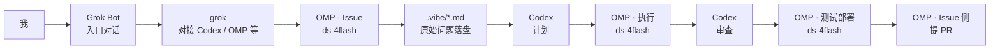

DeepSeek Harness 团队在 10 月 31 日发了一篇《[Super-agent 设计探索](https://blog.eimoon.com/p/deepseek-super-agent-design/)》，并开源了研究原型 [dsh-superagent-prototype](https://github.com/deepseek-ai/dsh-superagent-prototype)。圈子里很快开始讨论 Router–Worker、注意力预算、主动模式。我读完第一遍，没有急着再写厂商产品评测——上次已经写过 [Dots / Spark / Muse](/whz-blog/2026/10/10/dots-vs-spark-vs-muse/)——而是回头看自己桌上**正在跑**的那条链：

**Grok Bot 和我交互；grok 对接 Codex、OMP、Grok 等；几个 OMP Session（ds-4flash）和 Codex 各守一段。**

它当然还不是 Super-agent。但它已经在用「拆 Session、落盘、人闸门」换注意力。这篇就拿 DeepSeek 的尺子量一下自己，也顺便把角色写清楚，免得以后又被说成「又一个万能对话框」。产品侧比过 always-on，团队侧写过基建，个人侧总该有一篇讲清楚：活是怎么被拆开、钉住、再交回来的——这篇要补的，就是这一层。

> 说明：文中的 OMP、`.vibe`、角色分工是我当前的个人实践，不是公司标准流程；DeepSeek 原型是工程探讨与开源实验文稿，**不等于**已上线产品。

<!-- more -->

## 一、DeepSeek 说了什么（短复述）

### 1. 瓶颈换到了人的注意力

单任务越来越少需要人死盯。一个人通常只能跟进 **3–5 个活跃 Session**——多任务上限从「模型聪不聪明」，变成「人还能分几份心」。Super-agent 要解决的，首先是**少占注意力、多交结果**，而不是再堆一个更会聊天的窗口。

### 2. 四个特征

他们给目标画像画了四笔：

| 特征 | 大意 |
|------|------|
| **连续** | 跨 IM、GitHub 等入口，像同一个 Agent 在跟 |
| **高效** | 多任务并行，不必等上一条做完才开下一条 |
| **主动** | 观察事件，值得做才做；不该说话时闭嘴 |
| **持久** | 常在线，异常可恢复，状态不随对话窗关掉而丢 |

原型文档里有一句很直的哲学：**Take as little human attention as possible, and give as much value as possible.** 只在被请求或规则写明时行动；只在人必须行动或能用到结果时说话。

### 3. Router–Worker

架构上是双层：**Router** 对人、维护全局上下文、分派任务；**Worker** 隔离会话并发执行，**不直接对用户说话**，结果回 Router 再统一对外。外面再叠事件驱动、两级过滤（程序规则 + 模型判定）、Watchdog 等拼图。

开源仓是 MIT 的研究原型，用来讨论调度与注意力，不是「装上就能当个人特工」的产品说明书。下面对照时，我会借用这套词，但不会假装自己已经有完整 Router。

## 二、我这边的角色表与数据流

我没有一个统一的 Super-agent 进程。实际在跑的是：**入口一层 + 中间对接一层 + 多个专职 Session**。

| 角色 | 谁在干 | 干什么 |
|------|--------|--------|
| 入口 | **Grok Bot** | 和我对话：交代意图、确认计划、拍板合并、要结果 |
| 交互者 | **grok** | 作为和 Codex、OMP、Grok 等的交互者，把活接到对的能力上 |
| Issue + PR | **一个 OMP Session（ds-4flash）** | Issue 接收者与 PR 提交者；把 Issue 记到本地 md，放进 `.vibe`，写好原始问题 |
| 计划 + 审查 | **Codex** | 根据 Issue 做计划；执行后再做审查 |
| 执行 | **另一个 OMP Session（ds-4flash）** | 按计划改代码、落地变更 |
| 测试 + 部署 | **再一个 OMP（ds-4flash）** | 测试与部署相关步骤 |

白话补一句：这里的 **OMP** 可以理解成「多 Session 的 agent 运行时」一类工具；**ds-4flash** 是这些 Session 实际挂的模型。同一模型、不同 Session，靠**职责**拆开，避免一个窗口又写计划又改代码又提 PR。

**`.vibe` 是整条链的落盘点。** Issue 不是只活在聊天记录里，而是被写成带原始问题的 md，进本地 `.vibe`。后面的计划、执行、审查都围绕这份文件转，而不是围绕某次对话的滚动上下文。聊天可以飘，磁盘上要能回看「当初到底问了什么」。

和「一个 Agent 包办一切」比，这套分工的代价也很清楚：Session 多了，接线要有人（或 grok）记得找谁；模板松了，下游就会各写各的。收益则是：上下文更干净，审查有对照物，PR 描述不容易和原始问题脱节。我宁可多开几个专职窗口，也不想再维护一个「什么都聊过、什么都半记得」的超长线程。

用一张图串起来：

和 DeepSeek 概念的粗映射：

| DeepSeek 概念 | 我这边的近似物 |
|---------------|----------------|
| Router | 我 + Grok Bot（拍板），grok（接线） |
| Worker | 各个 OMP Session、Codex |
| Ticket / 任务载体 | `.vibe` 里的 Issue md |
| Mandate / 人闸门 | 合并前、对外推送前仍由我确认 |
| Watchdog | 基本还没有，异常靠人发现 |

差距很明显：**没有统一事件总线，也没有「Worker 永不直接对人」的硬约束**——Grok Bot 这条线本身就要跟人聊。我只是在**写代码 / 改仓库这条链**上，尽量把职责拆成多个 Session。

## 三、一条完整路径：Issue → PR

抽象成固定顺序，就是我现在默认走的七步。

### 1. Issue 进来

我在 Grok Bot 里说清要做什么，或从已有问题入口丢进来。Grok Bot 负责把意图问清楚；**grok** 负责接到 Codex / OMP 等对应能力上。这一步的产出不是代码，而是「足够让下游落盘的问题描述」。

### 2. OMP（Issue Session）写入 `.vibe`

专职收 Issue 的那个 OMP Session（ds-4flash）把**原始问题**写成 md，放进本地 `.vibe`。这一步故意保守：先忠实记录「问的是什么」，不急着改仓库。格式可以朴素，但要固定——标题、背景、期望结果、边界，至少能让下一棒不用猜。

对我来说，`.vibe` 的价值不是又一个笔记目录，而是**把「对话里的 Issue」变成「文件系统里的 Issue」**。后面谁挂了、哪个 Session 重启了，都能从同一份 md 续上。

### 3. Codex 出计划

Codex 读 Issue / `.vibe`，拆步骤、定边界、标风险。计划本身是可审查的产物：哪些文件可能动、先测什么、什么情况要停下来问人。执行 Session 不应在这一步重新定义需求。

### 4. OMP（执行 Session）落地

另一个 OMP Session（同样是 ds-4flash）只按计划改。不负责重新谈判范围，也不负责最后开口提 PR。这一拆很土，但管用——「会写」和「该不该写」尽量不要挤在同一个上下文窗口里互相污染。

### 5. Codex 再审查

同一角色（Codex）换帽子：对照计划和 diff 做审查——有没有跑偏、有没有漏测、有没有不该动的文件。计划和审查都偏「结构与风险」，交给 Codex；真正改文件的留给执行 Session。审查不过，就回到计划或执行，而不是直接硬提 PR。

### 6. OMP（测试 / 部署）

第三个 OMP 跑测试、做部署相关动作。和「写代码的 Session」分开，避免「刚改完就自己宣布过了」的自嗨。测试失败时，问题回到执行或计划，而不是跳过直接开 PR。

### 7. 回到 Issue 侧提 PR

仍由收 Issue 的那个 OMP Session 提交 PR。入口和出口收在同一侧，中间计划 / 执行 / 测试各管一段；PR 描述也能从 `.vibe` 原始问题对齐回去——审 PR 的人（往往还是我）不必再翻三屏聊天记录。

整条链里，**人真正必须出场的节点**通常是：Issue 表述是否够清楚、计划是否批准开干、审查有争议时怎么裁、PR 是否合并。中间的打字和跑命令，尽量别再占用同一块注意力。

有一点需要说破：这条路径**默认是同步编排，不是自治调度**。每一步谁先谁后，目前仍由约定和我（经 Grok Bot）推动。它解决的是「别让一个 Session 精神分裂」，还不是「后台自己把队列消化完再来敲门」。把预期摆正，后面对照 DeepSeek 的四特征才不会自我感动。

## 四、对照四个特征：哪里像，哪里还靠人盯

| 特征 | 我已经沾上的 | 还明显靠人盯的 |
|------|--------------|----------------|
| **连续** | 同一条 Issue 有 `.vibe` md 可接力；PR 能回溯原始问题 | 跨 IM / 多入口还没有「同一个 Agent 身份」；换窗口往往要我复述上下文 |
| **高效** | 计划 / 执行 / 测试拆 Session，不必全挤在一个对话里 | 没有自动调度器；下一个 Session 何时启动，多半还是人（或经 Grok Bot）喊一声 |
| **主动** | 很少。默认仍是「我开口才动」 | 几乎没有 observe→auto；不会自己扫仓库事件再决定要不要接单 |
| **持久** | `.vibe` + git 历史比纯聊天持久；PR 是对外的硬状态 | 没有独立 Watchdog；Session 挂了、环境脏了，要我发现并重启 |

和 DeepSeek 文里的注意力哲学比，我只做到了半截：

- **做到的**：少让一个窗口既当产品经理又当码农又当 QA；用落盘和角色拆分，把「上下文打架」压下去。
- **没做到的**：远谈不上「不该说话时闭嘴、只在人必须行动时出现」。Grok Bot 这条线本身就是高频对话入口——它适合当 Router 的人机面，不适合假装成静默的后台 Super-agent。

另外，团队侧我已经写过 [GitLab + Plane + Harbor + NewAPI](/whz-blog/2026/10/26/ai-team-architecture-gitlab-plane-harbor-newapi/)：那是协作与制品的骨架。个人侧这条 Grok Bot × Codex × OMP 链，解决的是**单人注意力怎么在多 Session 之间分配**。两边可以拼着看，但不要混成「我已经有完整 Super-agent」。

若硬要排改进优先级，我眼下更想先做稳两件小事，而不是一上来自研 Router：

1. **收紧 `.vibe` Issue 模板**——让计划和审查的输入永远够用；
2. **固定 Codex 计划 / 审查的输出格式**——让执行 Session 更少「猜下一步」。

模板稳了，再谈「谁在什么事件下自动接单」才有地方挂规则。否则所谓「主动」，很容易退化成又一个爱打扰人的通知机器人。

## 五、结语

读完 DeepSeek 那篇，我更确定一件事：

**我没有 Super-agent；我有的是注意力预算下的多 Session 编排。**

Grok Bot 对人，grok 接线，OMP 的 Issue / 执行 / 测试部署 Session 各守一段，Codex 管计划与审查，`.vibe` 把原始问题钉在磁盘上——这已经比「一个万能对话框从头聊到尾」省心。离他们说的连续、主动、持久，差的主要不是又一个更强的模型，而是**事件总线、静默 observe、以及真正的恢复与看门狗**。

下一步我大概不会急着抄一个 dsh-superagent 式的 Router 进程，而是先把落盘和闸门做稳。等这些习惯成了默认路径，再决定：继续「多人机角色 + 人当最终 Router」，还是把一部分分派写成真正的事件驱动。

参考：

- [DeepSeek《Super-agent 设计探索》转载](https://blog.eimoon.com/p/deepseek-super-agent-design/)
- [deepseek-ai/dsh-superagent-prototype](https://github.com/deepseek-ai/dsh-superagent-prototype)
